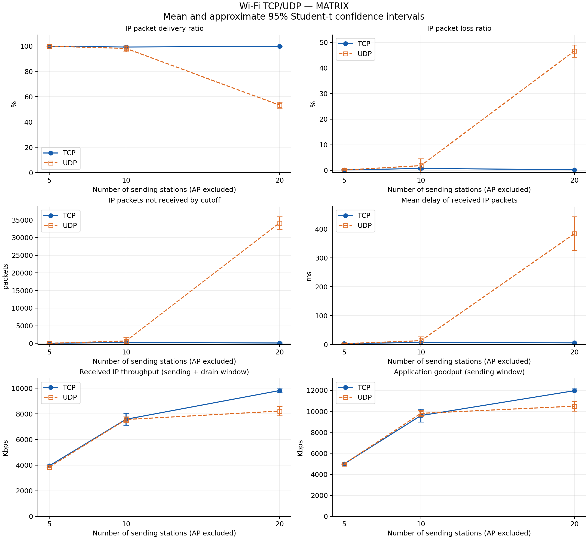

# Mô phỏng và đánh giá hiệu năng truyền thông

Đồ án môn **Lập trình mạng**: dùng ns-3.35 để so sánh TCP NewReno và UDP trong mạng Wi-Fi có trạm di động khi số trạm gửi tăng từ 5 lên 10 và 20.

| Thành viên | MSSV |
|---|---|
| Lê Nguyễn Trường Giang | 106230009 |
| Võ Huy Hùng | 106230014 |

## Mục tiêu

Đánh giá tỷ lệ gói IP đến đích (PDR), tỷ lệ mất gói IP, độ trễ IP và thông lượng khi thay đổi số trạm gửi. Goodput được đo thêm ở tầng ứng dụng để phân biệt dữ liệu hữu ích với lưu lượng IP.

Câu hỏi chính: với tốc độ yêu cầu cố định cho mỗi trạm, hiệu năng TCP và UDP thay đổi thế nào khi số thiết bị cùng sử dụng mạng tăng?

## Mô hình thí nghiệm

Một AP cố định tại tâm khu vực nhận dữ liệu từ các STA di động. Mỗi STA gửi một luồng riêng đến AP qua Wi-Fi một chặng, cổng đích `9000 + i`. TCP và UDP chạy riêng từng lượt.

| Tham số | Cấu hình |
|---|---|
| Bộ mô phỏng | ns-3.35, có hai bản sửa Wi-Fi được mô tả bên dưới |
| AP / số STA | 1 AP / 5, 10, 20 STA; số STA không bao gồm AP |
| Chuẩn Wi-Fi | IEEE 802.11a, kênh 20 MHz |
| Tốc độ PHY dữ liệu / điều khiển | 24 / 6 Mbps, cố định |
| MAC | Không QoS; RTS/CTS tắt |
| Kênh truyền | LogDistance, số mũ suy hao 3; reference loss 46.6777 dB tại 1 m |
| Công suất phát | 16 dBm |
| Khu vực | 50 × 50 m; AP tại (0, 0) |
| Chuyển động | RandomWalk2d, 1.5 m/s; đổi hướng mỗi 1 s |
| Giao thức | UDP và TCP NewReno |
| Ứng dụng nguồn | OnOff liên tục, tốc độ yêu cầu 1 Mbps/STA |
| Khối ghi ứng dụng / TCP MSS | 1024 byte / 1024 byte |
| Cửa sổ gửi | [3, 33) s |
| Thời gian xả / kết thúc | 10 s / t = 43 s |
| Ngẫu nhiên | Seed 12345, run 1–5 |
| Số lượt | 2 giao thức × 3 mức số trạm × 5 run = 30 |

Tăng số STA đồng thời tăng tổng tải yêu cầu và mức tranh chấp. Thiết kế này chưa cô lập riêng ảnh hưởng của mật độ hoặc chuyển động. Với cùng số STA, seed và run, TCP/UDP dùng cùng cấu hình vị trí và chuyển động nhờ tách các dải RNG stream.

## Yêu cầu và cách chạy

Cần Ubuntu/Linux hoặc Ubuntu trên WSL, Python 3 và ns-3.35 đã cấu hình/biên dịch, có các module Wi-Fi, Internet, Mobility, Applications, FlowMonitor và NetAnim. Không cần mở GUI NetAnim để chạy thí nghiệm.

```bash
git clone https://github.com/11legiang/N44_2026_LTM_009_014.git
cd N44_2026_LTM_009_014
python3 -m venv .venv
.venv/bin/python -m pip install -r requirements.txt
bash finish.sh
```

Nếu tạo venv báo thiếu `ensurepip`, cài `sudo apt install python3-venv`, rồi tạo lại.

Đường dẫn ns-3 mặc định là `~/ns-allinone-3.35/ns-3.35`. Để dùng đường dẫn khác:

```bash
bash finish.sh results/final-02 /duong/dan/ns-3.35
```

`finish.sh` kiểm tra và áp dụng bản sửa còn thiếu, sao lưu mã lõi trước khi sửa, chép chương trình vào `scratch/`, biên dịch, chạy 30 lượt và vẽ biểu đồ. Nếu thư mục kết quả đã có đủ lượt hợp lệ với cùng mã/cấu hình, lệnh giữ chúng và tạo lại phần phân tích. Nếu muốn chạy lại toàn bộ, chọn một thư mục kết quả mới.

Có thể dừng bằng Ctrl+C rồi chạy lại cùng lệnh để tiếp tục. Lượt thành công được xác minh và giữ nguyên; lượt thiếu/lỗi được chạy lại. Chương trình từ chối tiếp tục khi mã hoặc cấu hình khác bộ đã lưu.

Các lệnh bổ sung:

```bash
# Hai lượt ngắn TCP/UDP, 5 STA
bash quickstart.sh

# Một lượt riêng để khảo sát tham số
python3 scripts/run.py single --stations 20 --transport tcp --run-start 3 --out results/check-01

# Phân tích lại dữ liệu, không chạy mô phỏng
.venv/bin/python scripts/analyze.py results/final-01

# Ghi XML và mở NetAnim nếu đã cài GUI
bash show_network.sh
```

Trên WSL, có thể mở thư mục kết quả trong Windows:

```bash
explorer.exe "$(wslpath -w "$PWD/results/final-01")"
```

## Các đại lượng đo

FlowMonitor chỉ cộng các luồng STA → AP đúng IP nguồn, IP đích, giao thức TCP/UDP và cổng đích tương ứng. ACK TCP chiều ngược lại không được cộng vào chỉ số luồng gửi, nhưng vẫn chiếm tài nguyên mạng.

Gọi Tx, Rx là số gói IP gửi và nhận đến cutoff. Thông lượng và goodput trong CSV dùng **1 Kbps = 1000 bit/s**.

| Đại lượng / cột CSV | Cách tính |
|---|---|
| PDR / `pdr_ip_pct` | 100 × Rx / Tx |
| Mất gói / `loss_ip_pct` | 100 × (Tx − Rx) / Tx |
| `unreceived_ip_packets` | Tx − Rx; số gói chưa nhận đến cutoff |
| Trễ / `delay_ip_ms` | Tổng độ trễ gói IP nhận / Rx, đổi sang ms |
| `throughput_ip_kbps` | Byte IP nhận × 8 / ((duration + cleanup) × 1000) |
| `goodput_active_kbps` | Byte ứng dụng nhận trong cửa sổ gửi × 8 / (duration × 1000) |
| `goodput_full_kbps` | Byte ứng dụng nhận đến cutoff × 8 / ((duration + cleanup) × 1000) |
| `app_tx_accepted_bytes` | Byte socket nguồn đã chấp nhận; chưa đồng nghĩa đã nhận ở đích |

Khi có gửi nhưng nhận 0 gói, PDR = 0%, mất gói = 100%, độ trễ để trống. Lượt nhận 0 vẫn là dữ liệu hợp lệ; lỗi tiến trình/biên dịch được ghi riêng.

**Giới hạn khi đọc TCP:** lần truyền lại TCP được FlowMonitor đếm như gói IP mới; luồng còn có gói điều khiển cùng chiều. PDR IP không phải tỷ lệ dữ liệu ứng dụng nhận thành công. Trễ IP không bao gồm toàn bộ thời gian chờ ở ứng dụng/socket hay thời gian phục hồi dữ liệu TCP.

Tổng mạng được tính từ tổng bộ đếm, không lấy trung bình không trọng số của PDR từng trạm. Sau đó mỗi run là một mẫu thống kê. Trung bình và CI 95% Student-t được tính giữa 5 run; đây là khoảng xấp xỉ với số mẫu nhỏ. Mất gói và PDR là hai cách biểu diễn cùng tỷ lệ, không phải hai bằng chứng độc lập.

## Kết quả

Bộ `results/final-01/` được chạy trên Ubuntu/WSL của nhóm: **30 lượt thành công, 0 lỗi**. Trong bộ đếm đã kiểm tra, mọi STA đều nhận byte ứng dụng; hai đầu STA/AP cùng ghi nhận liên kết ngay trước lúc bắt đầu gửi.

Trung bình 5 lần mỗi cấu hình; goodput dưới đây là tổng goodput ứng dụng trong cửa sổ gửi, đổi sang Mbps:

| STA | Giao thức | PDR IP (%) | Mất IP (%) | Trễ IP (ms) | Goodput (Mbps) |
|---:|---|---:|---:|---:|---:|
| 5 | TCP | 99.84 | 0.16 | 2.66 | 5.00 |
| 5 | UDP | 99.89 | 0.11 | 2.47 | 4.99 |
| 10 | TCP | 99.24 | 0.76 | 6.91 | 9.60 |
| 10 | UDP | 98.14 | 1.86 | 12.85 | 9.81 |
| 20 | TCP | 99.76 | 0.24 | 5.34 | 11.97 |
| 20 | UDP | 53.33 | 46.67 | 384.00 | 10.49 |



Ở 5 STA, goodput hai giao thức gần tải yêu cầu tổng 5 Mbps. Ở 20 STA, UDP có PDR giảm và trễ IP tăng mạnh; TCP có PDR IP cao nhưng goodput chỉ khoảng 11.97 Mbps so với tổng tốc độ yêu cầu 20 Mbps. Kết quả cho thấy tải yêu cầu không đồng nghĩa với tốc độ nhận thực tế. Chưa thể xác định tỷ trọng từng nguyên nhân mất gói chỉ từ các bộ đếm tổng hợp này.

## Tổ chức mã và dữ liệu

| Đường dẫn | Nội dung |
|---|---|
| `src/wifi-transport-study.cc` | Topology AP/STA, chuyển động, nguồn/đích, FlowMonitor và xuất CSV |
| `scripts/run.py` | Lặp cấu hình, lưu tiến độ/log, xác minh dữ liệu và tiếp tục lượt thiếu |
| `scripts/analyze.py` | Tổng hợp, CI và biểu đồ; từ chối bộ dữ liệu thiếu nếu không cho phép rõ ràng |
| `scripts/fix_ns335.py` | Hai bản sửa lõi, nhận diện trạng thái đã sửa và sao lưu |
| `patches/ns335-wifi-fixes.patch` | Diff hai bản sửa so với mã ns-3.35 gốc |
| `results/final-01/` | Bộ dữ liệu nhóm đã chạy trên Ubuntu/WSL |
| `verification/` | Dữ liệu kiểm thử ở môi trường chuẩn bị mã; tách khỏi kết quả của nhóm |

Trong thư mục kết quả:

- `experiment.json`: cấu hình, hash mã mô phỏng/ba file lõi và thông tin môi trường.
- `status.json`: trạng thái và cảnh báo mỗi lượt.
- `runs.csv`: một dòng cho mỗi lượt hợp lệ.
- `aggregate.csv`: trung bình, SD, CI và số mẫu của từng chỉ số.
- `paired_differences.csv`: hiệu TCP − UDP ghép cặp theo N/seed/run.
- `comparison.png/.pdf`: sáu biểu đồ.
- `analysis_notes.txt`: cách đọc và cảnh báo.
- Mỗi thư mục `tcp-n20-r3/`, ... có cấu hình, log, CSV tổng/từng trạm và tọa độ đầu/cuối.

## Hai bản sửa Wi-Fi trong ns-3.35

1. **Va chạm nội bộ:** giới hạn `ReportDataFailed` cho frame có dữ liệu và địa chỉ đích unicast trong `FrameExchangeManager::NotifyInternalCollision`, tránh assertion trên frame nhóm đã gặp ở TCP 20 STA/run 1.
2. **Trạng thái liên kết AP:** thay callback `MpduResponseTimeout` bằng `DroppedMpdu` cho `ApWifiMac::TxFailed` và sửa chữ ký tương ứng, tránh ghi nhận thất bại liên kết ngay một lần timeout trước khi quá trình thử lại kết thúc.

Hai thay đổi được đối chiếu với mã chính thức ns-3.36. Thí nghiệm vẫn dùng **ns-3.35 có backport**, không phải bản 3.35 nguyên gốc. Script kiểm tra mẫu mã trước khi sửa, có backup và diff; không ép liên kết, đổi ARP timeout hoặc tắt assertion.

Kiểm thử ở môi trường chuẩn bị mã gồm ma trận 30 lượt với assertion bật, dừng/chạy tiếp, phát hiện dữ liệu sai và trường hợp nhận 0 gói. Kiểm tra N=20/run=3 cho cả TCP/UDP với cleanup 10 và 20 s cho cùng bộ đếm nhận, PDR, trễ và goodput cửa sổ gửi. Phép kiểm tra đó không chứng minh 10 s đủ cho mọi cấu hình tùy chỉnh. Xem `verification/TESTING.md`.

## Hạn chế

- Mạng Wi-Fi một chặng, không VANET, RSU, handover hoặc đường phố.
- RandomWalk và mô hình suy hao đơn giản chưa được hiệu chỉnh từ đo đạc thực tế.
- Không mô hình hóa tường, nhiễu mạng Wi-Fi khác hay thuật toán tự đổi tốc độ PHY.
- Chưa khảo sát riêng chuyển động hoặc tải tổng cố định khi tăng số STA.
- Năm run mỗi cấu hình giới hạn độ chính xác thống kê; các run này đã được dùng trong quá trình phát triển.
- Chưa đo độ trễ thông điệp ở tầng ứng dụng hoặc phân rã nguyên nhân mất gói bằng trace MAC/PHY.
- XML NetAnim đã được kiểm tra xuất/đọc ở môi trường chuẩn bị mã; GUI trên WSL phụ thuộc máy chạy.

## Nguồn tham khảo và giấy phép

Cấu trúc AP/STA tham khảo ví dụ `third.cc` của ns-3; đây là tham khảo kiến trúc, không phải baseline hiệu năng cùng cấu hình. Chương trình sử dụng các triển khai TCP/Wi-Fi của ns-3, thêm kịch bản, phép đo và quy trình chạy. Quá trình chuẩn bị mã và tài liệu có sử dụng công cụ AI hỗ trợ.

- [ns-3.35 release](https://www.nsnam.org/releases/ns-3-35/)
- [Ví dụ third.cc](https://github.com/nsnam/ns-3-dev-git/blob/ns-3.35/examples/tutorial/third.cc)
- [OnOffApplication](https://github.com/nsnam/ns-3-dev-git/blob/ns-3.35/src/applications/model/onoff-application.cc)
- [FlowMonitor](https://github.com/nsnam/ns-3-dev-git/blob/ns-3.35/src/flow-monitor/doc/flow-monitor.rst)
- [Quản lý biến ngẫu nhiên](https://github.com/nsnam/ns-3-dev-git/blob/ns-3.35/doc/manual/source/random-variables.rst)
- [FrameExchangeManager ns-3.36](https://github.com/nsnam/ns-3-dev-git/blob/ns-3.36/src/wifi/model/frame-exchange-manager.cc)
- [ApWifiMac ns-3.36](https://github.com/nsnam/ns-3-dev-git/blob/ns-3.36/src/wifi/model/ap-wifi-mac.cc)

Mã nguồn phân phối theo **GPL-2.0-only**. Xem [LICENSE](LICENSE).
